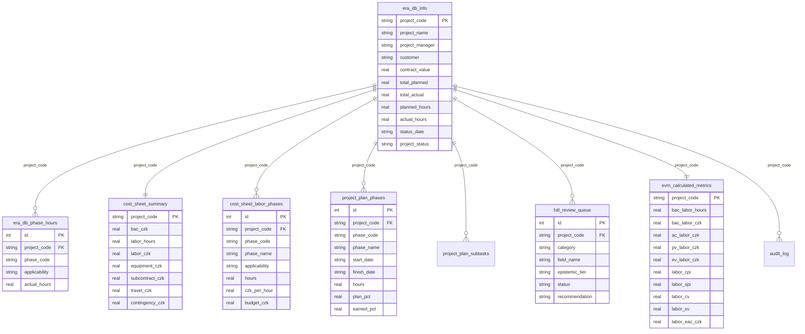

# ERA Hackathon 2026 – Relační databáze (SQL Schema & Architektura)

Tento repozitář obsahuje kompletní datovou základnu pro řízení a vyhodnocování projektů metodou Earned Value Management (EVM).

Data jsou normalizována z primárních zdrojů (**ERA Database.xlsx**, **Cost Sheet - SYN-*.xlsx** a **Project Plan - SYN-*.pdf**) a uložena v SQLite relační databázi a SQL dump souboru.

---

## 🌐 Online zhlédnutí a interaktivní SQL konzole
- **Živé online SQL Studio na GitHub Pages:** [https://jardaakarb.github.io/evm-mobile/database.html](https://jardaakarb.github.io/evm-mobile/database.html)
- **Kompletní SQL Dump soubor:** [era_hackathon_dump.sql](era_hackathon_dump.sql)
- **Mobilní EVM aplikace:** [https://jardaakarb.github.io/evm-mobile/](https://jardaakarb.github.io/evm-mobile/)

---

## 🗄️ Entitně-Relační Diagram (ERD)

---

## 📋 Přehled tabulek

1. **`era_db_info` (5 řádků):** Hlavní projektová data z účetního systému (kontrakty, celkové náklady, datum stavu, manažer).
2. **`cost_sheet_summary` (5 řádků):** Rozpad rozpočtu dle dodavatelského listu (Delivery BAC) na práci, materiál, subdodávky a rezervy.
3. **`evm_calculated_metrics` (5 řádků):** Exaktně spočtené indexy pracnosti (Labor CPI, SPI, EAC, CV, SV) a brány celoprojektového EVM.
4. **`era_db_phase_hours` (130 řádků):** Skutečně odpracované hodiny zaúčtované pro všech 26 etap (B0–A0).
5. **`cost_sheet_labor_phases` (130 řádků):** Plánované baseline hodiny a hodinové sazby pro 26 etap.
6. **`project_plan_phases` (130 řádků):** Harmonogramové fáze z primárních plánů (termíny, % dokončení).
7. **`project_plan_subtasks` (100 řádků):** Rozpad WBS na detailní subtasky.
8. **`hitl_review_queue` (20 řádků):** Fronta neshod k lidskému posouzení (kategorie, odchylka, doporučení).
9. **`audit_log` (16 řádků):** Záznamy o validaci a triangulaci dat.
